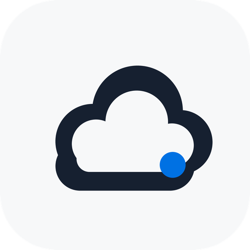
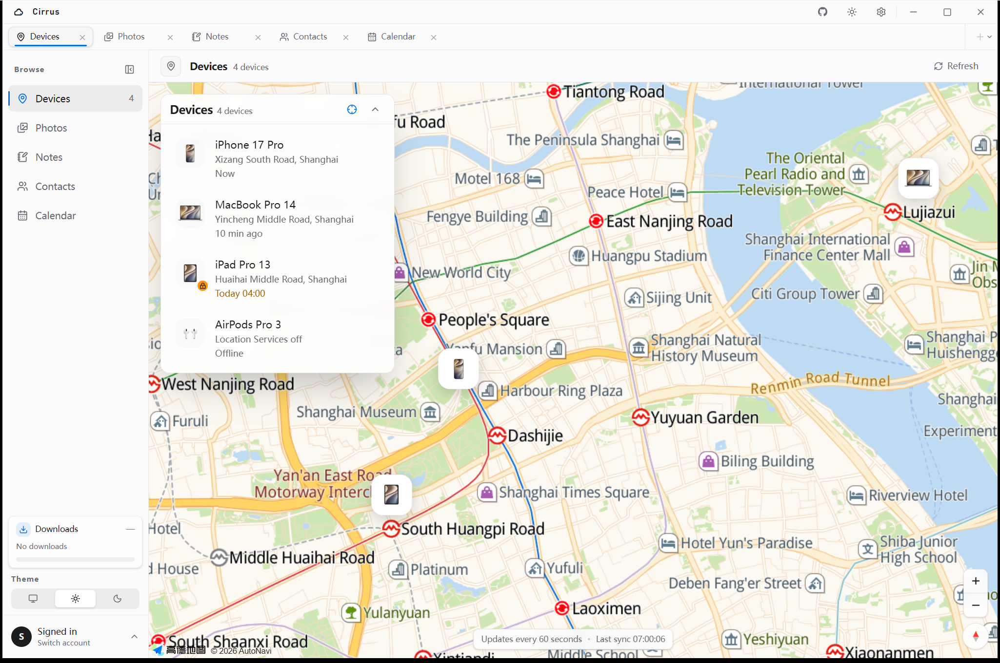

<div align="center">
  
  <h1>Cirrus</h1>

  <p><strong>A local-first iCloud desktop workspace for photos, devices, notes, contacts, and calendar.</strong></p>
  <p>Work directly with your iCloud data in a native window, with encrypted local sessions and configurable MCP access.</p>

  <p>
    
    
    
    
    
  </p>

  <p>English | <a href="README.zh-CN.md">简体中文</a></p>
</div>



<p align="center"><sub>Screenshots use mock accounts, simulated coordinates, and AMap tiles. No personal account, device, media, or note content is shown.</sub></p>

## Why Cirrus

Cirrus is a local-first desktop client for the iCloud services people use every day. It replaces a patchwork of browser tabs with one native workspace for photos, devices, storage, iCloud Drive, notes, contacts, and calendar.

| 5 | 19 | 13 | 3 |
|:--:|:--:|:--:|:--:|
| iCloud areas | MCP tools | client presets | desktop platforms |

- Native Tauri app for Windows, macOS, and Linux.
- One Apple ID and 2FA session across supported iCloud services.
- Original photo and video downloads with account-scoped history.
- Multi-account switching with encrypted local sessions.
- Configurable MCP access with per-account and per-tool switches.
- No Cirrus account, cloud relay, or telemetry.

## Features

### Photos and video

- Browse the iCloud Photo Library in a responsive grid.
- Open photos and videos in a full-screen viewer.
- Download original files instead of thumbnails.
- Download by date range with account-scoped task history.
- Configure download concurrency and bandwidth limits.
- Move selected photos and videos to Recently Deleted.

### Find My devices

- View iPhone, iPad, Mac, AirPods, and other Apple devices.
- See device artwork, battery, availability, and location status.
- Review Activation Lock and Lost Mode information.
- Play a sound directly from the device detail view.

### iCloud Drive and storage

- Browse and download files from iCloud Drive.
- Review total, available, and category usage from the iCloud storage quota endpoint.
- Open iCloud's storage management page directly from Cirrus.

### Notes, contacts, and calendar

- Create, edit, delete, browse, and retrieve image attachments from iCloud Notes with folders and search. MCP note reads can return text and images interleaved in document order.
- View contacts, phone numbers, email addresses, and postal addresses.
- Read calendar events in day, week, and month views.
- Keep each view ready when switching between workspace tabs.

### Desktop workspace

- 11 interface languages: English, Simplified and Traditional Chinese, Japanese, Korean, Spanish, French, German, Portuguese, Russian, and Arabic.
- Light, dark, system, and six color themes.
- Multiple Apple accounts with session reuse.
- Local storage for accounts, avatars, encrypted sessions, and download history.

### MCP

- Optional stdio and Streamable HTTP MCP access for AI clients and automation.
- Client configuration tabs for Claude Code, Cursor, CodeBuddy Code, ZCode, TRAE, VS Code, Windsurf, Codex, DeepSeek Harness, OpenCode, Pi, Cherry Studio, and Qoder.
- Per-account and per-tool MCP switches; accounts and tools are enabled by default and can be individually blocked.
- 26 MCP tools covering login, account status, devices, Find My sound, photo browsing and deletion, iCloud Drive, note CRUD and images, downloads, contacts, calendar, and profile images.
- Sign-in tool that asks for approval in Cirrus, then opens the native Cirrus sign-in window.
- MCP call history is stored in SQLite and available under **Settings → MCP → History**; requests and responses are bounded and redacted, with no tokens or image Base64 stored.
- Apple ID, password, and two-factor codes stay inside Cirrus and are never returned to the MCP client.
- Both transports are loopback-only and use a per-run random bearer token.

## Install

Download the latest build for Windows, macOS, or Linux from [GitHub Releases](../../releases/latest), or build from source below.

Windows requires WebView2. Linux runtime support requires WebKitGTK 4.1 and a Secret Service implementation.

## Build from source

Requirements:

- Node.js 22.13+
- pnpm 10+
- Rust 1.88+
- Windows 10/11 with WebView2
- macOS with Xcode Command Line Tools
- Linux with WebKitGTK 4.1, an AppIndicator library, and Secret Service development packages

```sh
pnpm install
make dev       # start the desktop app in development mode
make package   # build the platform installers
```

For map rendering, copy `.env.example` to `.env.local` and set:

```env
VITE_AMAP_KEY=
VITE_AMAP_SECURITY_CODE=
VITE_GOOGLE_MAPS_API_KEY=
```

`VITE_AMAP_KEY` is the AMap Web JS API key, and `VITE_GOOGLE_MAPS_API_KEY` is the Google Maps JavaScript API key. You can also choose a provider and enter its key under **Settings → Maps**, where it is stored in local SQLite.

For Google Maps, enable both Maps JavaScript API and Geocoding API in Google Cloud. Google Maps may be unavailable in mainland China. Map credentials are stored together in the app data SQLite database `cirrus.db` under the `cirrus.amap*` and `cirrus.googleMaps*` keys inside `app_state.desktop_settings`. On Windows the default database path is `%APPDATA%\com.cirrus\cirrus.db`.

## Usage

1. Sign in with your Apple ID and password.
2. Complete two-factor authentication.
3. Open **Devices**, **Photos**, **Storage**, **iCloud Drive**, **Notes**, **Contacts**, or **Calendar** from the sidebar or workspace tabs.

To use MCP, open **Settings → MCP**, enable the bridge, choose the matching client tab to copy or write its config, and turn off any iCloud account that MCP must not use. MCP exposes 26 account, device, photo browsing and deletion, iCloud Drive, note CRUD and image, download, contact, calendar, profile image, login, and logout tools. The `Streamable HTTP` tab shows the current `/mcp` endpoint, bearer token, and a ready-to-copy client configuration.

The first sign-in requires 2FA. Later launches restore the encrypted session when it is still valid.

## Privacy and storage

Cirrus runs entirely on your machine and talks directly to Apple. There is no Cirrus account, cloud relay, or telemetry service. The MCP bridge listens only on `127.0.0.1`, is enabled by default, and requires a per-run bearer token.

Local data is stored in:

```text
Windows: %APPDATA%\com.cirrus\cirrus.db
macOS:   ~/Library/Application Support/com.cirrus/cirrus.db
Linux:   ~/.local/share/com.cirrus/cirrus.db
```

- Account metadata and download tasks live in SQLite tables.
- Theme, language, map, download, sidebar, tab, MCP enabled state, and access policies live in the SQLite `app_state` table.
- MCP tool call history lives in the SQLite `mcp_call_history` table and keeps the latest 1000 entries by default.
- Frontend `localStorage` is only a startup cache; legacy localStorage and JSON settings are migrated into SQLite automatically.
- Cached avatars are stored locally.
- Session cookies and tokens are encrypted with AES-256-GCM before being written to SQLite.
- The encryption key is stored in Windows Credential Manager, macOS Keychain, or Linux Secret Service.
- Your password is never persisted.
- MCP ports and per-run tokens remain in a runtime discovery file rather than settings rows.

## Tech stack

- **Desktop shell:** Tauri 2
- **Backend:** Rust
- **Frontend:** Vue 3, TypeScript, Tailwind CSS
- **Storage:** SQLite with WAL
- **Map:** AMap Web API or Google Maps JavaScript API

## Development

```sh
pnpm typecheck
pnpm lint
pnpm test
cargo test --workspace
pnpm build:mcp   # optional MCP stdio executable for development
cargo clippy --workspace --all-targets -- -D warnings
```

The repository contains a Cargo workspace (`src-tauri`, `crates/cirrus-core`, and `crates/cirrus-mcp`) and a pnpm workspace (`apps/desktop`).

### MCP transports

Cirrus supports two MCP transports:

- **Streamable HTTP** runs inside the desktop process and listens on `http://127.0.0.1:5226/mcp` when enabled. It does not start a separate console process.
- **stdio** uses a `cirrus-mcp-server` launcher (`cirrus-mcp-server.exe` on Windows), matching DBX's `dbx-mcp-server` wrapper. The launcher starts the native `cirrus-mcp` binary with hidden Windows console handling while inheriting stdin/stdout for MCP. In development, Cirrus looks for it next to the running application, for example:

```text
target/debug/cirrus-mcp-server.exe
```

The desktop publishes its current loopback port and token in `mcp-bridge.json` under the Cirrus data directory; the stdio server reads that single discovery file before falling back to the legacy `mcp-bridge-port` and `mcp-bridge-token` files. `CIRRUS_DATA_DIR` can override the data directory for portable or development setups, and client configurations written by Cirrus pass the resolved directory through the server environment.

If **Settings → MCP** reports that the MCP launcher was not found, build the development executables first:

```sh
cargo build -p cirrus-mcp
# or
pnpm build:mcp
```

Reopen the MCP settings or restart Cirrus after building. For packaged builds, use `pnpm build:mcp:sidecar`; it builds and copies both `cirrus-mcp-<target>` and `cirrus-mcp-server-<target>` (with `.exe` suffixes on Windows), where `src-tauri/tauri.mcp.conf.json` includes both as Tauri sidecars in the installer.

### Standalone MCP installation

**Settings → MCP → Access → Local stdio** includes an MCP engine panel. It can independently install, update, reinstall, or uninstall the launcher and native binary under `~/.cirrus/bin`. New client configurations prefer this standalone launcher; if it is not installed, Cirrus falls back to the copies bundled with the desktop application.

The native executable can still be used manually for HTTP, and the launcher for stdio:

```sh
cirrus-mcp --http --http-host 127.0.0.1 --http-port 5226 --http-path /mcp
cirrus-mcp-server
```

## Limitations

- Release builds are not notarized; macOS may show a Gatekeeper warning.
- Linux session restore requires a Secret Service implementation.
- iCloud uses private web APIs that may change without notice.
- iCloud Drive currently supports browsing and downloading; uploading and deleting are not yet implemented.
- Note editing is plain text; notes with attachments remain read-only for now.
- Deleted photos and videos are moved to Recently Deleted and can be recovered from iCloud.
- The device map requires an AMap or Google Maps API key.
- Cirrus currently covers Photos, Find My, iCloud storage, iCloud Drive, Notes, Contacts, and Calendar, but not Mail.
- MCP exposes the main Cirrus account, device, photo, iCloud Drive, download, note, contact, and calendar operations over local stdio or Streamable HTTP.

## Trademarks and legal risk

Cirrus is an independent project. It is not affiliated with, endorsed by, sponsored by, or approved by Apple Inc.

The maintainer does not sell Cirrus or charge for its use. Non-commercial status may reduce some enforcement exposure, but it does not eliminate trademark, unfair-competition, platform-policy, or Apple service-terms risk. The Apache-2.0 license still permits downstream commercial use.

Apple, iCloud, Find My, iPhone, iPad, Mac, and AirPods are trademarks of Apple Inc. These names appear only in descriptive text to identify compatibility and supported features. Cirrus does not use Apple logos and does not present itself as an official Apple product.

Using a third-party trademark descriptively can still be challenged. In particular:

- Avoid using `iCloud` in the Cirrus product name, repository slug, domain, social handle, installer name, or logo.
- Do not use Apple logos, product artwork, or Apple-style branding in a way that suggests endorsement.
- No trademark clearance has been performed for `Cirrus`. Perform a separate trademark search before commercial distribution.
- The project uses undocumented iCloud web endpoints. This may stop working at any time and may conflict with Apple's terms of service.
- The Apache-2.0 license grants rights to the source code only; it does not grant any trademark rights.

This section is a practical notice, not legal advice. For public or commercial distribution, review Apple's trademark guidelines and consult qualified counsel.

## Disclaimer

Cirrus is an independent project and is not affiliated with, endorsed by, or sponsored by Apple Inc. It uses undocumented iCloud web endpoints and is intended for personal use and learning. Use it at your own risk and comply with Apple's terms of service.

## License

[Apache-2.0](LICENSE)
