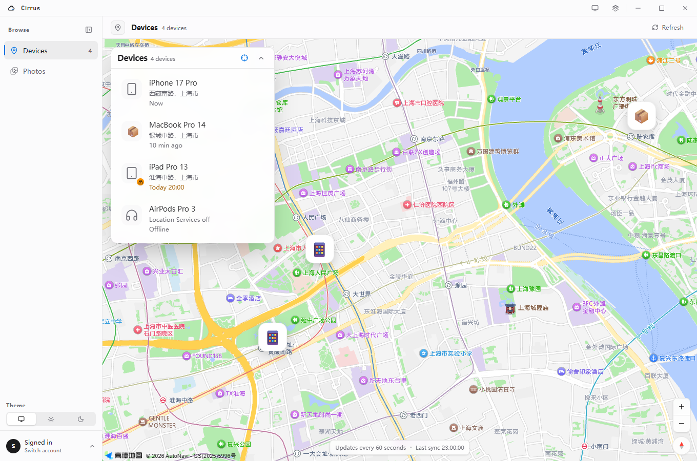

<div align="center">
  
  <h1>Cirrus</h1>

  <p><strong>开源的 iCloud 照片下载与 Find My 设备客户端，支持 Windows、macOS 和 Linux。</strong></p>
  <p>在一个原生桌面应用里浏览 iCloud 照片、下载原图，并定位 Apple 设备。</p>

  <p>
    
    
    
    
    
  </p>

  <p><a href="README.md">English</a> | 简体中文</p>
</div>



## 为什么是 Cirrus

Cirrus 是一个本地优先的 **Windows iCloud 桌面客户端**，把两个常用但浏览器体验不佳的流程放在一起：下载 **iCloud 照片**，以及通过 **Find My** 查找 Apple 设备。

- 原生 Tauri 窗口，不需要浏览器标签页、本地 HTTP 服务或监听端口
- 一次 Apple ID、密码和双重认证，同时用于照片与设备
- 支持原图、原视频和 Live Photo 下载
- 多账号切换、头像缓存、按账号隔离下载任务
- 使用 AES-256-GCM 加密会话，密钥保存在系统凭据存储

## 功能

### iCloud 照片

- 网格浏览 iCloud 照片图库
- 全屏查看照片和视频
- 下载原图，而不是缩略图
- 按日期范围下载，并保留账号级任务历史
- 设置下载并发数和带宽限制

### Find My 设备

- 查看 iPhone、iPad、Mac、AirPods 等 Apple 设备
- 地图显示位置、精度和最后更新时间
- 显示电量、激活锁和丢失模式状态
- 显示设备图标，并支持播放声音

### 桌面体验

- 英文和简体中文界面
- 浅色、深色和跟随系统主题
- 多 Apple 账号与会话复用
- 使用本地 SQLite 保存账号、头像、会话和下载历史

## 安装

从 [GitHub Releases](../../releases/latest) 下载 Windows、macOS 或 Linux 安装包，或从源码构建。

Windows 需要 WebView2；Linux 需要 WebKitGTK 4.1 和 Secret Service 实现。

## 从源码构建

环境要求：

- Node.js 22.13+
- pnpm 10+
- Rust 1.88+
- Windows 10/11 和 WebView2
- macOS 和 Xcode Command Line Tools
- Linux 和 WebKitGTK 4.1、AppIndicator 与 Secret Service 开发包

```sh
pnpm install
make dev       # 启动桌面开发环境
make package   # 构建当前平台安装包
```

地图功能需要把 `.env.example` 复制为 `.env.local`，并填写：

```env
VITE_AMAP_KEY=
VITE_AMAP_SECURITY_CODE=
```

## 使用

1. 输入 Apple ID 和密码。
2. 完成双重认证。
3. 打开 **Devices** 使用 Find My，或打开 **Photos** 浏览 iCloud 照片。

首次登录必须完成双重认证；之后只要会话仍有效，就会从本地加密记录中恢复。

## 隐私与存储

Cirrus 完全运行在本机，并直接连接 Apple。项目没有 Cirrus 账号、云端中转、遥测服务或本地 HTTP API。

本地数据位于：

```text
Windows: %APPDATA%\com.cirrus\cirrus.db
macOS:   ~/Library/Application Support/com.cirrus/cirrus.db
Linux:   ~/.local/share/com.cirrus/cirrus.db
```

- 账号信息和下载任务保存在 SQLite 表中
- 头像缓存在本地
- Cookie 和令牌先经过 AES-256-GCM 加密，再写入 SQLite
- 加密密钥保存在 Windows 凭据管理器、macOS Keychain 或 Linux Secret Service
- 密码不会持久化

## 技术栈

- **桌面框架：** Tauri 2
- **后端：** Rust
- **前端：** Vue 3、TypeScript、Tailwind CSS
- **存储：** SQLite（WAL）
- **地图：** AMap Web API

## 开发

```sh
pnpm typecheck
pnpm lint
pnpm test
cargo test --workspace
cargo clippy --workspace --all-targets -- -D warnings
```

仓库包含 Cargo workspace（`src-tauri`、`crates/cirrus-core`）和 pnpm workspace（`apps/desktop`）。

## 限制

- Release 构建未公证；macOS 可能显示 Gatekeeper 警告
- Linux 的会话恢复需要 Secret Service 实现
- 依赖 iCloud 私有 Web API，Apple 更新后可能需要适配
- 设备地图需要配置 AMap Key
- 当前只覆盖照片和 Find My，不包含 iCloud Drive、邮件、联系人或日历

## 商标与法律风险

Cirrus 是独立项目，与 Apple Inc. 不存在隶属关系，也未获得 Apple 的认可、赞助或批准。

维护者不出售 Cirrus，也不对使用收费。非商业性质可能降低部分执法和损害赔偿风险，但不等于免责，商标、不正当竞争、平台政策以及 Apple 服务条款风险仍然存在。Apache-2.0 也允许下游使用者将代码用于商业用途。

Apple、iCloud、Find My、iPhone、iPad、Mac 和 AirPods 是 Apple Inc. 的商标。这些名称仅出现在描述性文字中，用于说明兼容性和支持的功能。Cirrus 不使用 Apple Logo，也不会把自己包装成 Apple 官方产品。

描述性使用第三方商标仍可能被质疑。尤其需要注意：

- 不建议把 `iCloud` 放进 Cirrus 的产品名、仓库名、域名、社交账号、安装包名或 Logo。
- 不要使用 Apple Logo、产品图片或 Apple 风格视觉来暗示官方背书。
- 尚未对 `Cirrus` 进行商标检索和权利确认；商业化发布前应单独做商标检索。
- 项目使用未公开的 iCloud Web 接口，可能随时失效，也可能与 Apple 的服务条款冲突。
- Apache-2.0 只授予源码权利，不授予任何商标使用权。

以上内容是实际风险说明，不构成法律意见。公开发布或商业化前，请查阅 Apple 的商标指南并咨询专业律师。

## 免责声明

Cirrus 是独立项目，与 Apple Inc. 无关联，也未获得 Apple 认可。项目使用未公开的 iCloud Web 接口，仅供个人使用和学习。请自行承担账号风险，并遵守 Apple 的服务条款。

## 开源协议

[Apache-2.0](LICENSE)