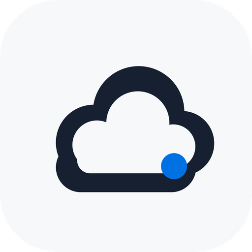
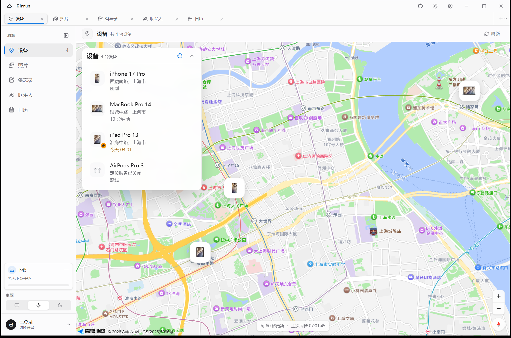

<div align="center">
  
  <h1>Cirrus</h1>

  <p><strong>本地优先的 iCloud 桌面工作区，覆盖照片、设备、备忘录、联系人与日历。</strong></p>
  <p>在原生窗口里直接使用 iCloud 数据，会话本地加密，MCP 访问可以逐账户、逐工具授权。</p>

  <p>
    
    
    
    
    
  </p>

  <p><a href="README.md">English</a> | 简体中文</p>
</div>



<p align="center"><sub>截图使用模拟账号、模拟经纬度和 AMap 底图，不包含个人账号、真实设备、照片或备忘录内容。</sub></p>

## 为什么是 Cirrus

Cirrus 是一个本地优先的 iCloud 桌面客户端，把日常会用到的照片、设备、存储空间、iCloud 云盘、备忘录、联系人和日历集中到一个原生工作区里，不必在多个网页之间来回切换。

| 5 | 19 | 13 | 3 |
|:--:|:--:|:--:|:--:|
| iCloud 功能域 | MCP 工具 | 客户端配置 | 桌面平台 |

- 原生 Tauri 应用，支持 Windows、macOS 和 Linux。
- 一次 Apple ID 与双重认证，覆盖已支持的 iCloud 服务。
- 下载原图与原视频，并按账号保留下载历史。
- 多账号切换，会话在本地加密保存。
- MCP 支持逐账户、逐工具授权。
- 没有 Cirrus 账号、云端中转或遥测服务。

## 功能

### 照片与视频

- 网格浏览 iCloud 照片图库。
- 全屏查看照片和视频。
- 下载原图，而不是缩略图。
- 按日期范围下载，并保留账号级任务历史。
- 设置下载并发数和带宽限制。
- 将所选照片和视频移到“最近删除”。

### Find My 设备

- 查看 iPhone、iPad、Mac、AirPods 等 Apple 设备。
- 查看设备外观、电量、在线状态和位置状态。
- 查看激活锁与丢失模式信息。
- 在设备详情页直接播放声音。

### iCloud 云盘与存储空间

- 浏览并下载 iCloud 云盘文件。
- 查看 iCloud 存储配额中的总容量、可用空间与各类别用量。
- 从 Cirrus 直接打开 iCloud 存储空间管理页面。

### 备忘录、联系人与日历

- 新建、修改、删除和按文件夹浏览 iCloud 备忘录，支持搜索和图片附件读取；MCP 可按正文顺序交错返回文字与图片。
- 查看联系人、电话、邮箱和地址。
- 以日、周、月视图查看，并新建、修改、删除日历事件。
- 切换工作区页签后保留各页面状态。

### 桌面体验

- 支持 11 种界面语言：英语、简体中文、繁体中文、日语、韩语、西班牙语、法语、德语、葡萄牙语、俄语和阿拉伯语。
- 浅色、深色、跟随系统与 6 套彩色主题。
- 多 Apple 账号与会话复用。
- 在本地保存账号、头像、加密会话和下载历史。

### MCP

- 可选的 stdio 和 Streamable HTTP MCP 接入，供 AI 客户端和自动化工具使用。
- 提供 Claude Code、Cursor、CodeBuddy Code、ZCode、TRAE、VS Code、Windsurf、Codex、DeepSeek Harness、OpenCode、Pi、Cherry Studio 和 Qoder 配置页签。
- iCloud 账户和 MCP 工具默认允许，可按账户、按工具单独关闭；关闭后服务端会拒绝调用。
- 28 个 MCP 工具覆盖登录、账户状态、设备、Find My 声音、照片浏览与删除、iCloud 云盘、备忘录增删改与图片、下载、联系人、日历事件增删改和头像图片。
- 登录工具会先在 Cirrus 中请求授权，然后打开原生 Cirrus 登录窗口。
- MCP 调用历史保存在 SQLite，可在 **设置 → MCP → 历史** 查看；请求和响应会截断并脱敏，不保存令牌或图片 Base64。
- Apple ID、密码和双重认证验证码始终留在 Cirrus 内，不会返回给 MCP 客户端。
- 两种传输都只监听本机回环地址，并使用每次启动随机生成的 Bearer Token。

## 安装

从 [GitHub Releases](../../releases/latest) 下载 Windows、macOS 或 Linux 安装包，或从源码构建。

Windows 需要 WebView2；Linux 需要 WebKitGTK 4.1 和 Secret Service 实现。

## 从源码构建

环境要求：

- Node.js 22.13+
- pnpm 10+
- Rust 1.88+
- Windows 10/11 和 WebView2
- macOS 和 Xcode Command Line Tools
- Linux 和 WebKitGTK 4.1、AppIndicator 与 Secret Service 开发包

```sh
pnpm install
make dev       # 启动桌面开发环境
make package   # 构建当前平台安装包
```

地图功能需要把 `.env.example` 复制为 `.env.local`，并填写：

```env
VITE_AMAP_KEY=
VITE_AMAP_SECURITY_CODE=
VITE_GOOGLE_MAPS_API_KEY=
```

`VITE_AMAP_KEY` 用于高德地图显示，必须是 Web 端（JS API）Key；`VITE_GOOGLE_MAPS_API_KEY` 用于 Google Maps JavaScript API。也可以在 **设置 → 地图** 中选择服务商并填写对应 Key，配置会保存到本机 SQLite。

使用 Google 地图时，需要在 Google Cloud 中同时启用 Maps JavaScript API 和 Geocoding API；Google 地图在中国大陆可能无法使用。地图配置统一保存在应用数据目录的 SQLite 数据库 `cirrus.db` 中，位于 `app_state.desktop_settings` 的 `cirrus.amap*` 和 `cirrus.googleMaps*` 键。Windows 默认数据库路径为 `%APPDATA%\com.cirrus\cirrus.db`。

## 使用

1. 输入 Apple ID 和密码。
2. 完成双重认证。
3. 从侧栏或工作区页签打开 **设备**、**照片**、**存储空间**、**iCloud 云盘**、**备忘录**、**联系人** 或 **日历**。

如需使用 MCP，打开 **设置 → MCP**，启用桥接，按客户端页签复制或写入配置，并关闭不允许 MCP 使用的 iCloud 账户。MCP 提供 28 个账户、设备、照片浏览与删除、iCloud 云盘、备忘录增删改与图片、下载、联系人、日历事件增删改、头像、登录和退出工具。`Streamable HTTP` 页签会显示本次运行的 `/mcp` 地址、Bearer Token 和可直接复制的客户端配置。

首次登录必须完成双重认证；之后只要会话仍有效，就会从本地加密记录中恢复。

## 隐私与存储

Cirrus 完全运行在本机，并直接连接 Apple。项目没有 Cirrus 账号、云端中转或遥测服务。MCP 桥接默认开启，仅监听 `127.0.0.1`，并要求每次启动随机生成的 Bearer Token。

本地数据位于：

```text
Windows: %APPDATA%\com.cirrus\cirrus.db
macOS:   ~/Library/Application Support/com.cirrus/cirrus.db
Linux:   ~/.local/share/com.cirrus/cirrus.db
```

- 账号信息和下载任务保存在 SQLite 表中
- 主题、语言、地图、下载、侧栏、页签、MCP 开关和权限等应用设置保存在 SQLite 的 `app_state` 表
- MCP 工具调用历史保存在 SQLite 的 `mcp_call_history` 表，默认保留最近 1000 条
- 前端 `localStorage` 只作为启动时的同步缓存；旧版本 localStorage 和 JSON 配置会自动迁移到 SQLite
- 头像缓存在本地
- Cookie 和令牌先经过 AES-256-GCM 加密，再写入 SQLite
- 加密密钥保存在 Windows 凭据管理器、macOS Keychain 或 Linux Secret Service
- 密码不会持久化
- MCP 端口和每次运行令牌保存在运行时发现文件中，不写入设置表

## 技术栈

- **桌面框架：** Tauri 2
- **后端：** Rust
- **前端：** Vue 3、TypeScript、Tailwind CSS
- **存储：** SQLite（WAL）
- **地图：** AMap Web API 或 Google Maps JavaScript API

## 开发

```sh
pnpm typecheck
pnpm lint
pnpm test
cargo test --workspace
pnpm build:mcp   # 开发时构建 MCP stdio 可执行文件
cargo clippy --workspace --all-targets -- -D warnings
```

仓库包含 Cargo workspace（`src-tauri`、`crates/cirrus-core`、`crates/cirrus-mcp`）和 pnpm workspace（`apps/desktop`）。

### MCP 传输方式

Cirrus 支持两种 MCP 传输：

- **Streamable HTTP** 在桌面主进程内运行，启用后监听 `http://127.0.0.1:5226/mcp`，不会再启动独立的控制台进程。
- **stdio** 直接启动独立的原生 `cirrus-mcp`（Windows 为 `cirrus-mcp.exe`）。它自己打开 Cirrus 数据库和加密会话保险箱，并在本地执行账号相关工具，因此不依赖桌面 HTTP bridge 是否运行。桌面应用只用于交互式登录以及旧版 bridge 兼容模式。原来的 `cirrus-mcp-server` launcher 仍保留为兼容入口。

开发模式下，Cirrus 会查找与当前程序同目录的原生可执行文件，例如：

```text
target/debug/cirrus-mcp.exe
```

便携或开发场景可用 `CIRRUS_DATA_DIR` 覆盖数据目录，Cirrus 自动写入的客户端配置会通过服务环境变量传递解析后的目录。默认使用真正的本地后端；只有显式设置 `CIRRUS_MCP_BACKEND=bridge`（或提供 `CIRRUS_MCP_URL` 与 `CIRRUS_MCP_TOKEN`）时才走桌面 bridge 兼容路径。无法访问系统凭据存储的无头环境可通过 `CIRRUS_SESSION_KEY` 或 `CIRRUS_SESSION_KEY_FILE` 提供已有保险箱密钥；独立服务不会自行生成新密钥。`CIRRUS_MCP_DOWNLOAD_SPEED_LIMIT` 可设置本地下载限速，单位为字节/秒。

如果 **设置 → MCP** 提示未找到 MCP 可执行文件，先构建开发用可执行文件：

```sh
cargo build -p cirrus-mcp
# 或
pnpm build:mcp
```

构建后重新打开 MCP 设置或重启 Cirrus。正式打包时使用 `pnpm build:mcp:sidecar`，脚本会构建并复制 `cirrus-mcp-<target>` 和 `cirrus-mcp-server-<target>`（Windows 带 `.exe` 后缀），再由 `src-tauri/tauri.mcp.conf.json` 将两者一起作为 Tauri sidecar 打入安装包。

### 独立 MCP 安装

**设置 → MCP → 访问 → 本地 stdio** 中提供 MCP 引擎面板，可以独立安装、更新、重新安装或卸载原生二进制与旧版兼容 launcher，安装目录为 `~/.cirrus/bin`。新的客户端配置会优先使用原生 `cirrus-mcp`；未安装时自动回退到桌面应用内置的副本。

stdio 和 HTTP 都使用同一个原生可执行文件：

```sh
cirrus-mcp
cirrus-mcp --http --http-host 127.0.0.1 --http-port 5226 --http-path /mcp
cirrus-mcp --authorize-keychain  # 交互式授权一次系统凭据访问
cirrus-mcp-server  # 旧版 launcher，转发到 cirrus-mcp
```

不要把 `--authorize-keychain` 写进 MCP 客户端参数；仅在系统凭据存储需要后台访问授权时，从终端运行一次。

## 限制

- Release 构建未公证；macOS 可能显示 Gatekeeper 警告
- Linux 的会话恢复需要 Secret Service 实现
- 依赖 iCloud 私有 Web API，Apple 更新后可能需要适配
- iCloud 云盘目前支持浏览和下载，暂不支持上传与删除
- 备忘录编辑会保留已有穿插图片，并可修改图片周围的文字；暂不支持新增、删除或移动附件
- 删除的照片和视频会先移到“最近删除”，可在 iCloud 中恢复
- 重复日程在当前版本中暂时只读
- 设备地图需要配置 AMap 或 Google Maps API Key
- 当前覆盖照片、Find My、iCloud 存储空间、iCloud 云盘、备忘录、联系人和日历，不包含邮件
- MCP 已覆盖账户、设备、照片、iCloud 云盘、下载、备忘录、联系人和日历等主要操作，支持本地 stdio 和 Streamable HTTP

## 商标与法律风险

Cirrus 是独立项目，与 Apple Inc. 不存在隶属关系，也未获得 Apple 的认可、赞助或批准。

维护者不出售 Cirrus，也不对使用收费。非商业性质可能降低部分执法和损害赔偿风险，但不等于免责，商标、不正当竞争、平台政策以及 Apple 服务条款风险仍然存在。Apache-2.0 也允许下游使用者将代码用于商业用途。

Apple、iCloud、Find My、iPhone、iPad、Mac 和 AirPods 是 Apple Inc. 的商标。这些名称仅出现在描述性文字中，用于说明兼容性和支持的功能。Cirrus 不使用 Apple Logo，也不会把自己包装成 Apple 官方产品。

描述性使用第三方商标仍可能被质疑。尤其需要注意：

- 不建议把 `iCloud` 放进 Cirrus 的产品名、仓库名、域名、社交账号、安装包名或 Logo。
- 不要使用 Apple Logo、产品图片或 Apple 风格视觉来暗示官方背书。
- 尚未对 `Cirrus` 进行商标检索和权利确认；商业化发布前应单独做商标检索。
- 项目使用未公开的 iCloud Web 接口，可能随时失效，也可能与 Apple 的服务条款冲突。
- Apache-2.0 只授予源码权利，不授予任何商标使用权。

以上内容是实际风险说明，不构成法律意见。公开发布或商业化前，请查阅 Apple 的商标指南并咨询专业律师。

## 免责声明

Cirrus 是独立项目，与 Apple Inc. 无关联，也未获得 Apple 认可。项目使用未公开的 iCloud Web 接口，仅供个人使用和学习。请自行承担账号风险，并遵守 Apple 的服务条款。

## 开源协议

[Apache-2.0](LICENSE)
